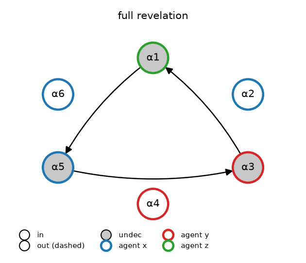
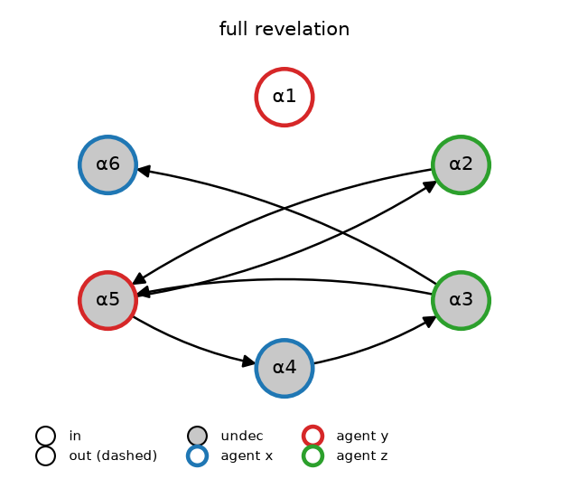
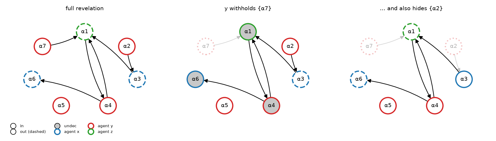
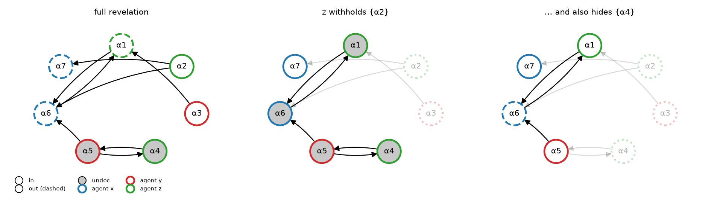
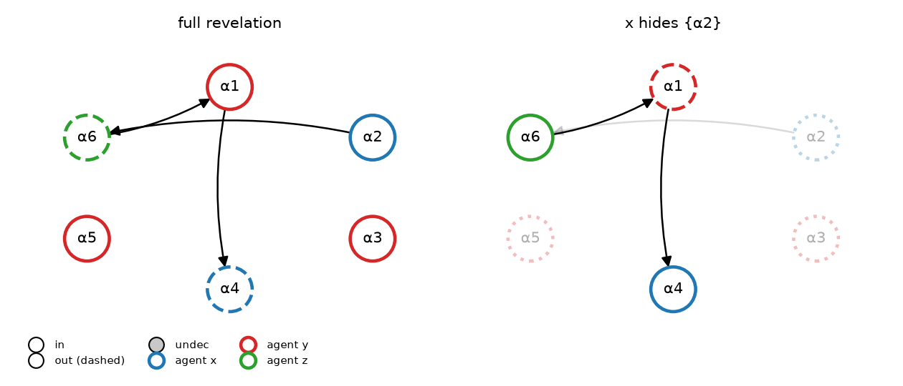
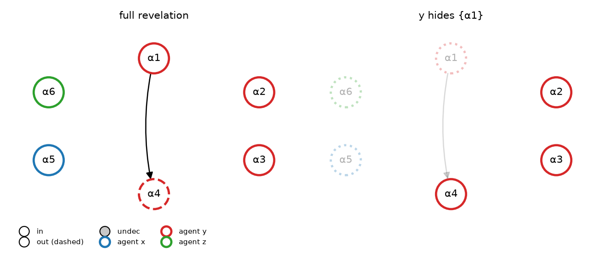

# Representative Q3 instances

### Instance #203 (p = 0.15, n = 6, |R| = 3)

Types: A_x = {α2, α5, α6}; A_y = {α3, α4}; A_z = {α1}.

Odd paths inside a type (simple-path reading): x: α5 → α3 → α1 → α5; y: α3 → α1 → α5 → α3; z: α1 → α5 → α3 → α1.

* Agent x: **dormant**.
* Agent y: **dormant**.
* Agent z: **dormant**.

### Instance #970 (p = 0.15, n = 6, |R| = 6)

Types: A_x = {α4, α6}; A_y = {α1, α5}; A_z = {α2, α3}.

Odd paths inside a type (simple-path reading): x: α4 → α3 → α5 → α4; y: α5 → α4 → α3 → α5; z: α2 → α5 → α4 → α3; z: α3 → α5 → α4 → α3.

* Agent x: **dormant**.
* Agent y: **dormant**.
* Agent z: **dormant**.

### Instance #900 (p = 0.15, n = 7, |R| = 6)

Types: A_x = {α3, α6}; A_y = {α2, α4, α5, α7}; A_z = {α1}.

Odd paths inside a type (simple-path reading): x: α3 → α1 → α4 → α6; y: α2 → α3 → α1 → α4.

* Agent x: **dormant**.
* Agent y: **self-neutralised**.
  Hiding {α2} raises {α4} to IN only when y also withholds {α7} (revealed set {α1, α2, α3, α4, α5, α6}). Once y reveals {α7}, those arguments block the gain, so against truth-telling there is nothing to gain.

### Instance #296 (p = 0.15, n = 7, |R| = 8)

Types: A_x = {α6, α7}; A_y = {α3, α5}; A_z = {α1, α2, α4}.

Odd paths inside a type (simple-path reading): z: α4 → α5 → α6 → α1.

* Agent z: **self-neutralised**.
  Hiding {α4} raises {α1} to IN only when z also withholds {α2} (revealed set {α1, α4, α5, α6, α7}). Once z reveals {α2}, those arguments block the gain, so against truth-telling there is nothing to gain.

### Instance #254 (p = 0.15, n = 6, |R| = 3)

Types: A_x = {α2, α4}; A_y = {α1, α3, α5}; A_z = {α6}.

Odd paths inside a type (simple-path reading): x: α2 → α6 → α1 → α4.

* Agent x: **offset**.
  Against the others revealing {α1, α6}, hiding {α2} brings in {α4} but loses {α2} (net change +0).

### Instance #224 (p = 0.15, n = 6, |R| = 1)

Types: A_x = {α5}; A_y = {α1, α2, α3, α4}; A_z = {α6}.

Odd paths inside a type (simple-path reading): y: α1 → α4.

* Agent y: **offset**.
  Against the others revealing {}, hiding {α1} brings in {α4} but loses {α1} (net change +0).

